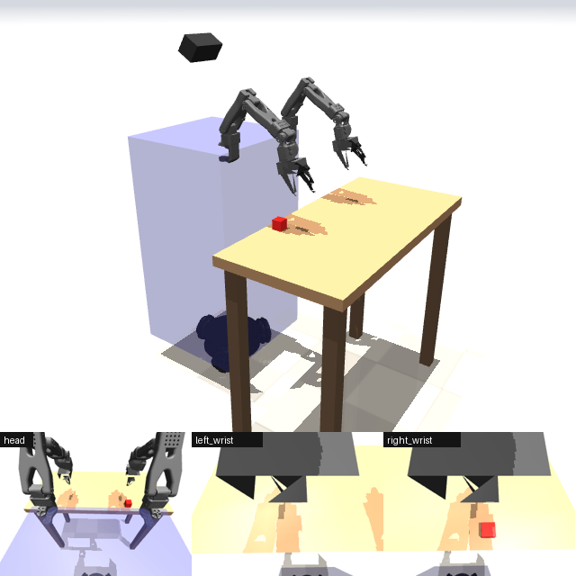

# XLeRobot pick-cube (MuJoCo) — EnvHub prototype

A LeRobot [EnvHub](https://huggingface.co/docs/lerobot/envhub) environment for XLeRobot: the
three-omniwheel robot (0.3.0) in front of a table, picking up a red 3 cm cube. Its state, actions
and cameras use the names and units of the `xlerobot` LeRobot plugin, so one policy or dataset works
with `--robot.type=sim` on this environment and `--robot.type=xlerobot --robot.use_degrees=true` on
the real robot.

Status: prototype. It runs with LeRobot 0.7, from this directory or from the Hub as
[`VectorW/xlerobot-pick-cube-mujoco`](https://huggingface.co/VectorW/xlerobot-pick-cube-mujoco)
(private for now). The Hub copy carries the robot model in `xlerobot/`. See
[What to verify on a real robot](#what-to-verify-on-a-real-robot) before relying on sim-to-real
transfer.



|             |                                                                                                                                                                                                                                                                  |
| ----------- | ---------------------------------------------------------------------------------------------------------------------------------------------------------------------------------------------------------------------------------------------------------------- |
| Observation | `pixels`: `head`, `left_wrist`, `right_wrist`, 480×640 RGB by default; `agent_pos`: the 17 values below                                                                                                                                                           |
| State and action | in the plugin's order: `left_arm_*` (6), `right_arm_*` (6), `head_motor_1`, `head_motor_2` as `<motor>.pos`, then `x.vel`, `y.vel`, `theta.vel`. Joints in degrees, grippers 0 (closed) to 100 (open), base in m/s and deg/s in the robot frame (x forward, y left) |
| Control     | arms and head: absolute position targets; base: body velocity. 30 fps                                                                                                                                                                                                 |
| Task        | "Pick up the red cube from the table."                                                                                                                                                                                                                           |
| Reward      | cube height above its resting height, divided by 5 cm and clipped to [0, 1]                                                                                                                                                                                      |
| Episode end | success (terminated) when the cube is 5 cm up; truncated after 900 steps (30 s), set with `episode_length`                                                                                                                                                        |
| Reset       | arms over the table edge, grippers half open, head tilted down; seeded joint noise (±2°) and cube position noise (±3 cm)                                                                                                                                         |

`LEROBOT_SIM` in `env.py` declares `robot_type: xlerobot` and the semantics
`xlerobot-joint-degrees-v1`.

## Use with LeRobot 0.7

Run these from the repository root. On Windows, pass the environment as a relative path: LeRobot
reads `dir:file` in `hub_path`, so a drive letter such as `D:` is taken for the separator.

Drive the environment as a robot, here with a policy:

```bash
lerobot-rollout --strategy.type=base \
  --robot.type=sim --robot.env.type=envhub --robot.env.hub_path=simulation/envhub \
  --robot.env.trust_remote_code=true --robot.env.task=xlerobot_pick_cube \
  --policy.path=<your XLeRobot checkpoint> --task="Pick up the red cube from the table." --duration=30
```

Serve it from another process or machine, then add `--robot.env.server.endpoint=tcp/127.0.0.1:7448`
to the command above. LeRobot 0.7.0 trusts the repository's code when serving it with `--envhub`:

```bash
pip install "lerobot[remote]"
lerobot-env-server --envhub=simulation/envhub
```

In-process:

```python
from lerobot.envs import HubEnvConfig, make_env

envs = make_env(HubEnvConfig(hub_path="simulation/envhub", trust_remote_code=True), n_envs=1)
```

`--env.make_env_kwargs` (or `make_env_kwargs` above) overrides the defaults of `XLeRobotEnv`: image
size, cameras, episode length, joint and cube noise. Headless Linux machines need `MUJOCO_GL=egl`.

### Scripted demonstrations

`scripted_demos.py` records a LeRobot dataset of right-arm pick-ups. It needs the `xlerobot_model`
plugin package, whose IK it uses. The demonstrator knows the cube's pose: it aims the shoulder at the
cube and keeps only the episodes that lift it. By default it records the `head` and `right_wrist`
cameras at 320×240.

```bash
python simulation/envhub/scripted_demos.py --root data/xlerobot_pick_cube --episodes 50
lerobot-train --policy.type=act --dataset.repo_id=local/xlerobot_pick_cube_scripted \
  --dataset.root=data/xlerobot_pick_cube --policy.push_to_hub=false
```

## Model and conventions

- **Robot model:** `../mujoco/xlerobot.xml`. The Hub copy carries it, with the meshes it uses, in an
  `xlerobot/` folder next to `env.py`; `env.py` looks there first.
- **Additions at build time:**
  - `env.py` adds position actuators for the head and a box for the head, since the model's head
    has no geometry.
  - It adds the three cameras and some rotor inertia on the light gripper jaws.
- **Contact groups:** robot parts touch the table and the cube, but not each other or the floor.
  The model's arm meshes overlap the cart body once the arms bend down, and those contacts made the
  simulation diverge.
- **Base:** driven at the commanded body velocity on two slide joints and a hinge, as in
  `../mujoco/xlerobot_mujoco.py`. The wheels and their floor contact are not simulated. The base
  still stops against the table.
- **Arm naming:** the MJCF names its arms as seen from in front of the robot, so its `_R` arm is the
  robot's left arm. `JOINT_MAP` maps by physical side.
- **Joint units:** joint values follow `software/src/model/SO101Robot.py`:
  - `shoulder_lift = 90 − Pitch` and `elbow_flex = Elbow − 90`, in degrees;
  - the other joints map directly.
  
  With all joints at 0, the arms are in the calibration pose: upper arms up and forearms forward.

## What to verify on a real robot

These are the parts of the mapping that the simulation cannot confirm:

- **Joint signs:** the signs of `shoulder_pan`, `wrist_flex`, `wrist_roll` and both head motors.
  Command the same values on both and compare the poses.
- **Gripper range:** the gripper's range, mapped here to 0–1.6 rad of the jaw.
- **Camera placement and field of view:** set from the model's links, not measured on the robot.
- **Units:** the robot must run with `--robot.use_degrees=true`. With the plugin's default
  (`-100..100` per joint), values depend on each robot's calibration and do not match the
  simulation.

## Testing the plugins without hardware

`../sil/check_plugin.py` connects the real `xlerobot` plugin to this simulation through a virtual
servo bus. See [`../sil/README.md`](../sil/README.md).

## Files

| File               | Content                                                                    |
| ------------------ | -------------------------------------------------------------------------- |
| `env.py`           | the EnvHub entry point (`make_env`), the Gymnasium env and `LEROBOT_SIM`   |
| `scene.xml`        | the room, table, cube and lights; the robot is attached at `robot_mount`   |
| `requirements.txt` | the environment's dependencies                                             |
| `media/`           | images for this README                                                     |
